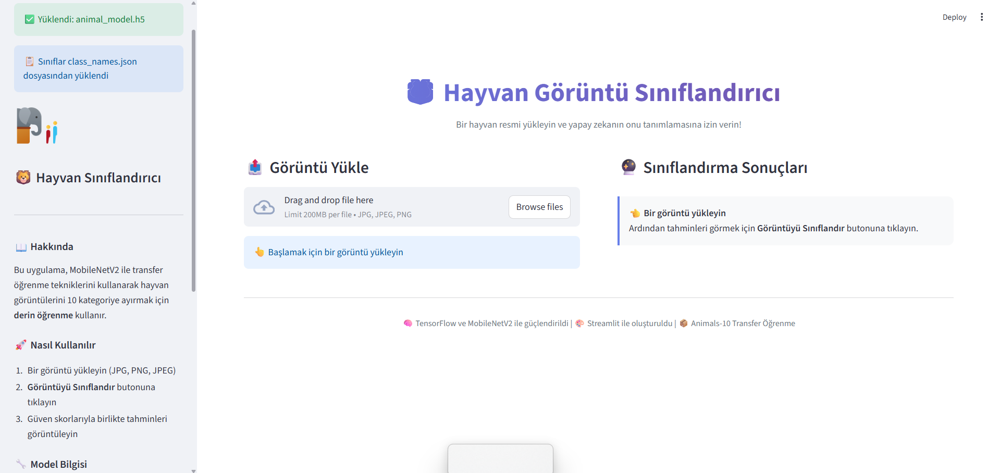
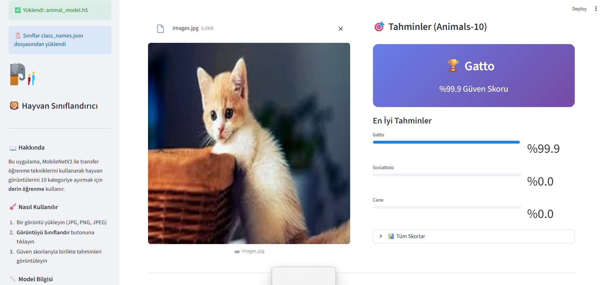

# AI-Powered Image Classifier

A deep learning system that classifies 10 animal species (dog, horse, elephant, butterfly,
chicken, cat, cow, sheep, spider, squirrel) using **Transfer Learning** on the
**MobileNetV2** architecture, served through an interactive Streamlit web interface.



## Overview

End-to-end machine learning workflow: data preprocessing, two-phase transfer learning,
and deployment via a web UI. MobileNetV2 — a lightweight, low-latency model optimized for
mobile and web — is used as the backbone.

### Core Components

| Component | File | Description |
|---|---|---|
| **Model Trainer** | `model_trainer.py` | OOP-based training engine with hyperparameter management |
| **Image Processor** | `image_processor.py` | Preprocessing utilities for training and inference |
| **Web UI** | `app.py` | Streamlit interface for real-time predictions |

---

## Tech Stack

- **Deep Learning:** TensorFlow 2.x / Keras
- **Pre-trained Model:** MobileNetV2 (ImageNet weights)
- **Web Interface:** Streamlit
- **Language:** Python 3.8+
- **Libraries:** NumPy, Pillow

---

## Model Architecture

- **Base Model:** MobileNetV2 (`include_top=False`) pre-trained on ImageNet
- **Custom Head:** Global Average Pooling -> Dropout -> Dense (Softmax, 10 classes)
- **Input Size:** 224 x 224 x 3 (RGB)
- **Optimizer:** Adam with Categorical Crossentropy loss

### Two-Phase Training Strategy

1. **Phase 1 — Feature Extraction:** base model frozen, only the new classification head is trained.
2. **Phase 2 — Fine-Tuning:** the last N layers of the base model are unfrozen and trained
   with a reduced learning rate.

### Callbacks

- `EarlyStopping` — stops training when validation loss stops improving
- `ReduceLROnPlateau` — lowers the learning rate on plateaus
- `ModelCheckpoint` — saves the best-performing model

### Data Augmentation

Rotation, zoom, and shift transformations are applied during training to reduce overfitting.

---

## Setup

```bash
git clone https://github.com/yavuzhankursun/ai-image-classifier.git
cd ai-image-classifier

python -m venv venv
source venv/bin/activate      # Windows: venv\Scripts\activate

pip install -r requirements.txt
```

> If you hit a `google.protobuf` error: `pip install --upgrade protobuf`

---

## Dataset

This project uses the [Animals-10](https://www.kaggle.com/datasets/alessiocorrado99/animals10)
dataset from Kaggle (~600 MB, ~26k images across 10 classes).

**The dataset and trained model weights are intentionally not committed to this repository**
— they are build artifacts, not source code. Download them locally:

```bash
# Option 1 — Kaggle CLI (requires ~/.kaggle/kaggle.json)
pip install kaggle
kaggle datasets download -d alessiocorrado99/animals10 -p data --unzip

# Option 2 — manual
# Download from the Kaggle link above and extract into: data/raw-img/
```

Expected layout after download:

```
data/raw-img/
├── cane/         # dog
├── cavallo/      # horse
├── elefante/     # elephant
├── farfalla/     # butterfly
├── gallina/      # chicken
├── gatto/        # cat
├── mucca/        # cow
├── pecora/       # sheep
├── ragno/        # spider
└── scoiattolo/   # squirrel
```

Class folder names are Italian, as in the original dataset. At least 200 images per class
is recommended.

---

## Usage

### 1. Train the model

```bash
python model_trainer.py --data-dir "data/raw-img" --epochs 20 --fine-tune-epochs 10
```

| Flag | Description | Default |
|---|---|---|
| `--data-dir` | Path to the dataset | — |
| `--epochs` | Phase 1 training epochs | — |
| `--fine-tune-epochs` | Phase 2 fine-tuning epochs | — |
| `--batch-size` | Training batch size | 32 |

Training automatically:
- splits data into training/validation sets (80/20)
- applies data augmentation
- saves the best model to `animal_model.keras`
- exports label mapping to `class_names.json`

### 2. Launch the web interface

```bash
streamlit run app.py
```

**Features:**
- Drag-and-drop image upload
- Top-3 predictions with confidence scores
- **Fallback:** if no trained model is found, the generic ImageNet model is loaded so the
  interface stays usable

Sample images for testing are in `samples/` — one per class.



---

## Project Structure

```
.
├── app.py                 # Streamlit web interface
├── model_trainer.py       # Training engine (OOP)
├── image_processor.py     # Image preprocessing utilities
├── class_names.json       # Label mapping
├── requirements.txt       # Python dependencies
├── samples/               # Sample images for quick testing (one per class)
├── docs/                  # Screenshots
└── data/raw-img/          # Dataset — downloaded locally, not tracked in git
```

Generated at runtime and excluded via `.gitignore`: `animal_model.keras`,
`training_log.txt`, `data/`.

---

## Performance Notes

- MobileNetV2 is light enough to run inference on CPU.
- To add a class: create a folder under `data/raw-img`, add images, retrain.

---

## License

MIT — see [LICENSE](LICENSE).
